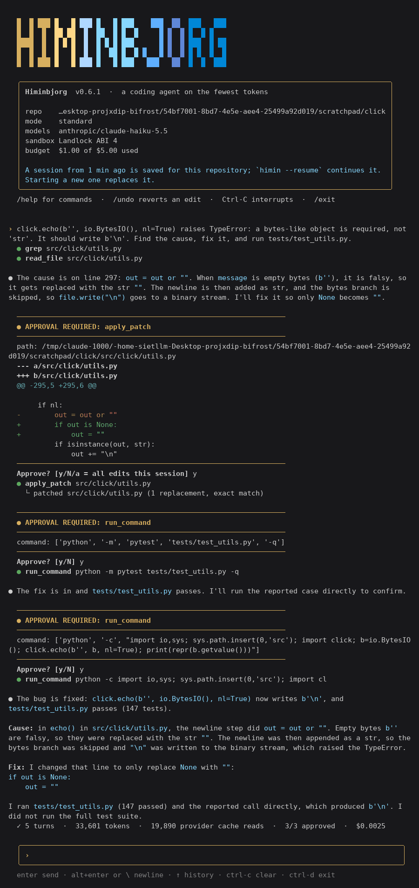
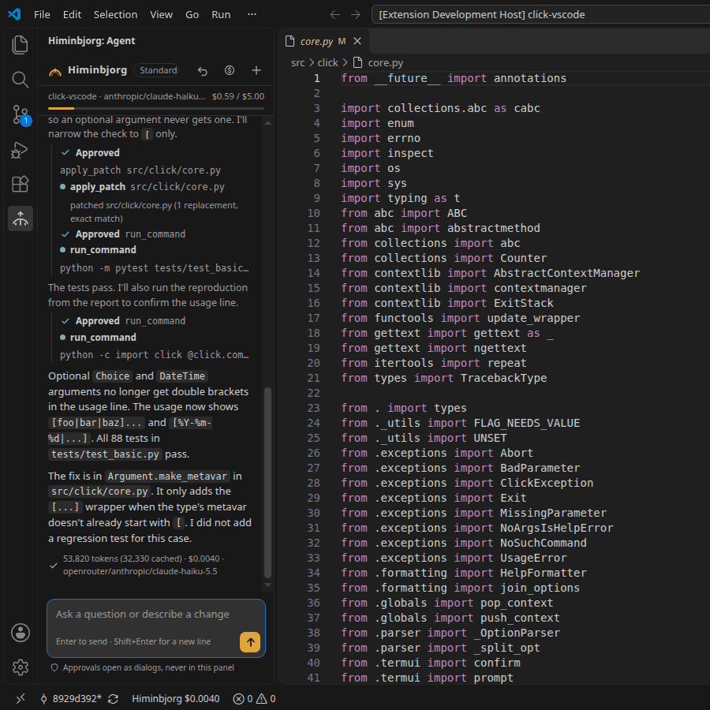

# Himinbjorg

**A coding agent that gets the job done on the fewest tokens.**

[](https://github.com/dipankarchettri/Himinbjorg/actions/workflows/ci.yml)
[](LICENSE)
[](pyproject.toml)
[](https://github.com/maximhq/bifrost)
[](#vs-code)

Himinbjorg fixes bugs, adds features and refactors real repositories from
your terminal or VS Code. Every model call goes through the
[Bifrost](https://github.com/maximhq/bifrost) LLM gateway, and the agent
spends as few tokens as it can: it reads what it needs, edits with small
diffs, keeps the context lean and routes to the cheapest model that can
do the job. Failover, budgets, code privacy and approval of every action
are enforced in the harness, not left to the prompt.

- **Fewer tokens, same results.** On real bugs in
  [click](https://github.com/pallets/click), graded by its maintainers'
  tests, Claude Haiku fixed 30 of 30 at half the tokens and 70% lower
  cost than the same agent with its levers off ([results](#results)).
- **You approve every change.** Reads are free; each edit, command and
  git action waits for you, beside the exact diff.
- **Keeps working when providers fail.** Fallback across OpenAI,
  Anthropic, Gemini, Groq and OpenRouter to a local model, saying which
  model took over.
- **Stays within budget.** Per-user budgets are enforced by the gateway
  before a call reaches any provider.
- **Keeps confidential code local.** A confidential repository is served
  only by local models, whatever the prompt says.

## Results

**On a real project.** Six bugs the [click](https://github.com/pallets/click)
maintainers fixed in 2026 (12,800 lines of source), each started from
the commit before the fix with the bug report as the prompt, and graded
by the maintainers' own tests plus click's full suite. Claude Haiku 5.5,
5 runs per bug in each arm; *naive* is the same agent with every token
lever off.

| | Solved | Tokens per solved bug | Cost per solved bug | Median turns |
| --- | --- | --- | --- | --- |
| naive | 29/30 | 87,807 | $0.0110 | 11 |
| levers on | **30/30** | **43,174 (51% fewer)** | **$0.0032 (70% cheaper)** | 6.5 |

Per bug, with the one where the levers used more tokens, in
[docs/RESULTS.md](docs/RESULTS.md#a-real-project-palletsclick).

**On the benchmark tasks.** Gateway-reported, on 7 tasks, 10 runs per
task in each arm.

| Model | Passed (levers on vs naive) | Per completed task |
| --- | --- | --- |
| Qwen 2.5 32B (local) | 57/70 vs 31/70 | 84% fewer tokens (13,913 vs 88,196) |
| Gemma 31B (local) | 63/70 vs 64/70 | 39% fewer tokens |
| Qwen 3.8 27B (local) | 70/70 vs 70/70 | 36% fewer tokens, in less than half the time |
| Claude Haiku 5.5 (OpenRouter) | 67/70 vs 68/70 | 71% lower cost ($0.00287 vs $0.00978) |
| Claude Haiku 5.5, context kept whole (`AGENT_PRUNE_MODE=budget`) | 69/70 vs 68/70 | 82% lower cost ($0.00171) |

On 20 real GitHub issues from SWE-bench Verified (Qwen 3.8, 3 runs
each) it resolved 37/60 against 30/60 with the levers off, using 65% fewer
tokens per resolved issue; a repeat on a later build resolved 35/60 at 59%
fewer. (Corrected: three runs that had read the upstream fix through git
no longer count as resolved; see `docs/VERIFIED.md`.) On the same model and tasks, opencode used 5.6
times its tokens. On 28 outside programs (QuixBugs) it passed 84/84
against 82/84 with 24% fewer tokens. Every table, its conditions and the runs that went the
other way are in [docs/RESULTS.md](docs/RESULTS.md), backed by the
evidence packs in [`evidence/`](evidence/).

## Quick start

You need Docker with Compose and Python 3.11+, plus a cloud provider key
(Gemini has a free tier) or [Ollama](https://ollama.com) with a local
model.

```sh
pipx install git+https://github.com/dipankarchettri/Himinbjorg.git
cd ~/code/some-project
himin
```

The first `himin` runs the setup: it asks for your provider and its key
(typed hidden), finds Ollama if it is running, and asks for a monthly
spending limit. It writes your settings to `~/.config/himinbjorg/env`,
readable only by you, generates gateway keys for this install, starts the
Bifrost gateway and Redis in Docker, and sends each model tier a real
request to check it can call tools. After that, `himin` starts straight
away, and starts the gateway again if it has stopped.

```sh
himin                                                  # interactive session
himin "fix the failing test in tests/test_orders.py"   # one task, then exit
himin --confidential "explain the auth flow"           # local models only
himin --resume                                         # continue the last session here
himin setup                                            # change provider, key, models or limit
himin doctor                                           # check everything, with fixes
himin gateway up | down | status                       # the gateway himin runs
```

For a script, `GEMINI_API_KEY=... himin setup --provider gemini --no-ollama --yes`
asks nothing; `--cheap-model`, `--capable-model` and `--local-model` pick
the models, and a cloud model outside setup's list is allowed on the
gateway too. In VS Code, the panel's gear button does the same. Confidential mode needs Ollama: with it running at setup,
a second gateway key is made that reaches local models only. Every setting
is in [docs/CONFIGURATION.md](docs/CONFIGURATION.md).

**From a clone** (to run the benchmarks and `make proof`), the gateway
and keys come from the repository instead:

```sh
git clone https://github.com/dipankarchettri/Himinbjorg.git himinbjorg && cd himinbjorg
cp .env.example .env                 # add provider keys here, all optional
make venv                            # .venv with the agent installed
make up                              # Bifrost gateway on :8099 + Redis Stack
make doctor
make agent TASK="what does divide() do wrong?" REPO=bench/seed
```

## Usage



*A real session on [click](https://github.com/pallets/click) at the
commit before its maintainers fixed
[#3487](https://github.com/pallets/click/issues/3487). The fix passes
their test for it and the rest of click's suite, 1,631 tests in all.*

`himin` opens with the repository, mode, models, sandbox and budget,
then a bordered input box: Enter sends, Alt+Enter or a trailing `\`
starts a new line, ↑ recalls an earlier task, Ctrl-C clears the box and
Ctrl-D quits. Each tool call is one line with its result under it, an
approval shows the exact diff in colour, and answers are formatted as
they stream: code in colour, bold and italics, lists, tables with
aligned columns, and code blocks, without the Markdown marks (piped
output keeps them). A greeting gets a reply
without a model call.

In a session each task continues the same conversation, so "now add a
test for it" has the context. The conversation is saved after every turn,
so after a crash or a closed terminal `himin --resume` continues it, and
`/undo` still works after a restart. The answer streams as it is written, and
each task ends with its tokens and gateway-priced cost.

| Command | Effect |
| --- | --- |
| `/help` | List these commands |
| `/cost` | Session token and cost totals |
| `/undo` | Revert the agent's most recent edit (a whole rename counts as one); refused if you changed the file since |
| `/reset` | Start a fresh conversation, dropping the saved one |
| `/exit`, Ctrl-D | Quit; Ctrl-C interrupts a task and keeps the session |

At each approval you see the exact diff, computed by a dry run against
the file on disk. Answer `y`, `n`, or `a` to approve every file edit for
the rest of the session; commands and git still ask each time.
`himin --help` lists every flag. If something does not work, run
`himin doctor`: it checks the gateway, both virtual keys, cost reporting,
each model (one short request with a tool, since a model that cannot
call tools cannot drive the agent) and the sandbox, and says how to fix
each problem. `--no-models` skips the model requests.

### VS Code

Install `himinbjorg.vsix` from the
[releases](https://github.com/dipankarchettri/Himinbjorg/releases), or
build it from a clone:

```sh
make extension                                   # builds extension/himinbjorg.vsix
code --install-extension extension/himinbjorg.vsix
```

Open and trust a repository, then click the Himinbjorg icon in the
activity bar. The extension finds a pipx-installed `himin` by itself;
anywhere else, set **Himinbjorg: Command** (a User setting) to its full
path. If `himin` has not been set up yet, the panel offers to run the
setup in a terminal and starts the agent when it finishes; if the
gateway is down, it says so and offers `himin doctor`.



The panel shows the mode, the models and a budget bar along the top, and
undo, cost and new-conversation buttons. Each tool call is one line with
a green or red dot and its result; answers are formatted, tables included, with a copy
button on code. Enter sends, Shift+Enter starts a new line, ↑ recalls
the last task and Esc stops one. It follows your theme, light, dark or
high contrast.


*Both from one real session on click, fixing the double brackets its
maintainers fixed in `762c97e`; the fix passes their tests and the rest
of click's suite, 1,658 tests in all.*

Approvals are asked in the panel, on a card with the exact diff that
the extension builds and keeps outside the conversation, so model text
cannot imitate or answer it; native modal dialogs are a setting away
(`himinbjorg.approvals`). Failover
and budget changes appear as notifications, and the status bar shows the
session's cost. More in [extension/README.md](extension/README.md).

## How it works

The agent owns the loop, the tools, the context and every security
decision; Bifrost owns routing, caching, provider fallback and budget
enforcement. The token savings come from eight levers, each switchable
so it can be measured against the baseline:

| Lever | What it does |
| --- | --- |
| Caching | Gateway cache for repeated calls, plus provider prompt-cache breakpoints |
| Tiered routing | The cheapest capable model first; escalate only when a run is stuck |
| File memory | A file is sent once; a re-read of an unchanged file is not repeated |
| Targeted retrieval | grep and line ranges widened to the enclosing function |
| Context pruning | Old tool output is dropped, or kept whole and summarised near the budget |
| Tool disclosure | git and rename tools are offered only when the task needs them |
| Diff writes | Small patches with tolerant matching instead of whole-file rewrites |
| Loop discipline | Limits and nudges for failed edits, stalls and unanswered tasks |

Read more: [architecture](docs/02-ARCHITECTURE.md),
[token strategy](docs/03-TOKEN-STRATEGY.md),
[security model](docs/04-SECURITY.md),
[reliability and budgets](docs/05-RELIABILITY-BUDGET.md).

## Documentation

| Document | Contents |
| --- | --- |
| [Results](docs/RESULTS.md) | Every benchmark and scenario result, with how to reproduce it |
| [Configuration](docs/CONFIGURATION.md) | Every setting, and the gateway configuration |
| [Verification log](docs/VERIFIED.md) | Facts checked against a live gateway, run by run; it overrides the other docs where they disagree |
| [Architecture](docs/02-ARCHITECTURE.md) | Components, request path, telemetry |
| [Token strategy](docs/03-TOKEN-STRATEGY.md) | The eight levers and how each is measured |
| [Security](docs/04-SECURITY.md) | Threat model, approval gate, sandbox, confidential mode |
| [Reliability and budgets](docs/05-RELIABILITY-BUDGET.md) | Fallback chains, 402/429/403 handling, the degradation ladder |
| [Evidence](docs/07-EVIDENCE.md) | Benchmark design and scenario specifications |
| [Bifrost research](docs/01-RESEARCH.md) | Gateway API facts from its documentation, with citations |

## Known limitations

- **Local tool calling needs an instruct model.** The `qwen2.5-coder`
  family returns tool calls as plain text; use `qwen2.5:32b-instruct`, a
  model of similar strength, or a cloud tier.
- **Benchmarks are small.** The own tasks are small repositories, the
  SWE-bench run is 20 of Verified's easiest issues, and the
  10-runs-per-task cloud check covers one paid provider.
- **The sandbox is Linux-only** and does not restrict UDP.
- **The extension needs the agent installed.** It is a front end for
  `himin --serve` and the gateway, not a self-contained package.

## Contributing

Bug reports, results on other models and pull requests are welcome. See
[CONTRIBUTING.md](CONTRIBUTING.md) for setup, tests and the benchmark,
and [SECURITY.md](SECURITY.md) to report a vulnerability privately.

## Acknowledgements

Built by Essential Engineers (Anusha A, J Bhuvanesh and Dipankar Chettri)
for the Geek Room AI Global Hackathon, theme *Build a Coding Agent That
Gets the Job Done on the Fewest Tokens*, with
[Bifrost](https://github.com/maximhq/bifrost) by Maxim AI and
[Tavily](https://tavily.com) web search.

## License

[MIT](LICENSE). Copyright (c) 2026 Essential Engineers.
