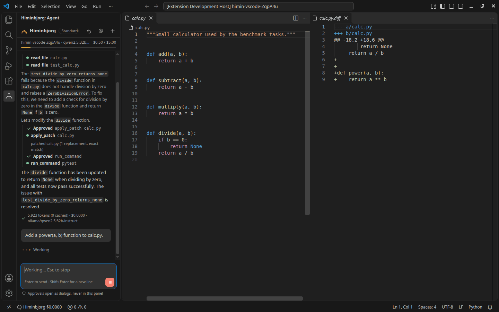
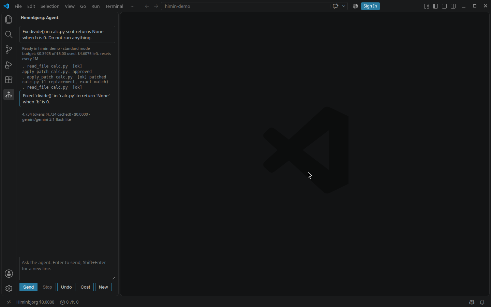

# Himinbjorg

[](https://github.com/dipankarchettri/Himinbjorg/actions/workflows/ci.yml)

A token-efficient coding agent, as a CLI and a VS Code extension, on the [Bifrost](https://github.com/maximhq/bifrost)
LLM gateway. It fixes bugs, adds features and refactors real repositories
while spending as few tokens as it can, and it enforces failover, per-user
budgets, code privacy and action approval in the harness, not in the prompt.

Built for the Geek Room AI Global Hackathon, theme **Build a Coding Agent
That Gets the Job Done on the Fewest Tokens** (Bifrost by Maxim AI), by team
Essential Engineers: Anusha A (lead), J Bhuvanesh and Dipankar Chettri. The
name is Heimdall's hall at the end of the Bifrost bridge, where the gate is
kept.

**Headline result:** on 7 benchmark tasks, 10 runs each at temperature 0.7,
it passes 57/70 against 31/70 for the same agent with every lever off, using
**84% fewer tokens per completed task** (13,913 vs 88,196). All numbers are
gateway-reported; the evidence pack is committed in
[`evidence/20261115-050124/`](evidence/20261115-050124/). The headline pools
two 5-repeat packs; `make pool` reproduces the table below from them, while a
single `make proof` run produces a fresh 5-repeat pack.

## Contents

- [Features](#features)
- [Results](#results)
- [Technologies used](#technologies-used)
- [Quick start](#quick-start)
- [Usage](#usage)
- [Configuration](#configuration)
- [How it works](#how-it-works)
- [Testing and proof](#testing-and-proof)
- [Project layout](#project-layout)
- [Documentation](#documentation)
- [Known limitations](#known-limitations)
- [License](#license)

## Features

Each requirement of the theme, how it is enforced, and where it is proven:

| Requirement | How it is enforced | Proof |
| --- | --- | --- |
| **Reliability**: survive outages and rate limits, say which model took over | Bifrost fallback chains across providers (OpenAI, Anthropic, Gemini, Groq, OpenRouter, then local). The agent announces every fallback, including on the first call, pins the working model for 60 s, then retries the primary and says when it is back. A provider out of credit (its own 402) drops that tier without touching your budget | Scenario 2, [`bench/failover_scenario.py`](bench/failover_scenario.py) |
| **Budget**: per-user limits enforced before the model call | A Bifrost governance budget per virtual key returns 402 before any provider is reached. The agent drops a tier, then stops and shows the quota | Scenario 3, [`bench/budget_scenario.py`](bench/budget_scenario.py) |
| **Privacy**: confidential repos stay on local models, whatever the prompt says | A `.agent-confidential` file or `--confidential` selects a local-only virtual key with an empty fallback chain, no web search and no cache. An egress check before every HTTP call refuses any non-local model | Scenario 4, [`bench/privacy_scenario.py`](bench/privacy_scenario.py) |
| **Approval**: reads are free; writes, shell and git need explicit approval | A gate that takes no conversation input asks on the terminal, or in a VS Code modal dialog, and shows the exact diff. Two denials stop the task. Text in files or prompts cannot grant anything. On Linux an approved command runs in a Landlock sandbox: it writes only inside the repository and cannot reach the network | Scenario 5, [`bench/approval_scenario.py`](bench/approval_scenario.py), plus `make gate-check` |
| **Fewer tokens, same correctness** | Eight stacked levers, each measured against an all-off baseline on the same binary | Scenario 1, [`bench/benchmark.py`](bench/benchmark.py) |

It runs in a terminal (`himin`) or in VS Code, where approvals are native
dialogs beside the exact diff (see [VS Code](#vs-code)).

Day-to-day features: an interactive session that keeps context between
tasks, diff previews at every approval, `/undo` for the agent's last edit,
a per-task report of tokens, cache hits and gateway-priced cost, and
[Tavily](https://tavily.com) web search for docs and error messages
(no approval needed; absent in confidential mode).

## Results

From the committed evidence pack, all 7 stages PASS:

| Scenario | Result |
| --- | --- |
| 0 unit tests | 107 passing in the pack (218 today): security, edit tools, agent loop, task checkers |
| 1 token efficiency (7 tasks x 10 runs, T=0.7) | 57/70 passed vs 31/70 naive; 13,913 vs 88,196 tokens per completed task (84% fewer). On the 21-file repository: 20/30 vs 3/30 |
| 1 on a second model: same 7 tasks x 10 runs, Gemma 31B (local vLLM) | 63/70 passed vs 64/70 naive; 23,513 vs 38,536 tokens per completed task (39% fewer). Gemma is strong enough to pass naive, so the levers save tokens but add no passes; optimized cost more on add_power and shop_freeship |
| 1 outside tasks: QuixBugs, 28 programs x 3 runs (Gemma 31B, local vLLM) | 84/84 passed vs 82/84 naive; 15,339 vs 20,078 tokens per completed task (24% fewer). Every tier is the same model here, so routing contributes nothing; optimized used more tokens on 7 of the 28 |
| 1b identical re-run | 4,402 -> 0 provider tokens, every call served from the semantic cache |
| 2 failover | PASS: broken OpenAI -> Anthropic -> local, with attribution |
| 3 budget | PASS: usage reset to $0, 6 calls served, then 402 before the provider |
| 4 privacy | PASS: 6 structural checks under an adversarial prompt |
| 5 approval | PASS automated; the interactive half verified by a human |

On cloud models (`docs/VERIFIED.md` has the full tables and conditions):

| Run | Result |
| --- | --- |
| Gemini, 7 tasks x 3 runs per arm (Flash-Lite cheap, 3.5 Flash capable, free tier) | 18/21 vs 16/21 passed; 67% fewer tokens and 76% lower gateway-priced cost per completed task than everything on 3.5 Flash |
| Claude Haiku via OpenRouter, prompt caching | 59-81% of Claude prompt tokens read from cache; input cost 31-57% of uncached. A stable prefix (`AGENT_PRUNE_STEP=4`, now the default) cut the remainder by about a quarter |
| Failover with real provider errors | Gemini Pro 429 -> Groq gpt-oss-120b, cross-provider, attributed |
| Budget at real prices (Gemini 3.5 Flash-Lite, priced by Bifrost) | PASS: $0.005 budget, 8 calls served, 402 on call 9; overshoots by at most one call (14%) |
| T2 -> T1 -> T0 ladder under real budgets (Gemini $0.0008, Groq $0.0006, local Gemma free) | PASS in 2 of 3 runs: the gateway's log shows each cloud provider skipped for `budget_exceeded`, and all three served calls. The third failed the check when Groq rejected gpt-oss-120b's malformed output while still under budget |

Disclosed caveats: scenario 3 in the pack uses synthetic pricing for local
models (the real-price runs are in the table above); one task (`shop_freeship`) is solved by neither arm; and the first
run of the 21-file tasks went the other way (optimized 1/15, naive 8/15).
What changed after that run, and why, is in
[`docs/VERIFIED.md`](docs/VERIFIED.md).

## Technologies used

| Technology | Role |
| --- | --- |
| [Bifrost](https://github.com/maximhq/bifrost) by Maxim AI | Gateway for every model call: provider fallback chains, semantic cache (on Redis Stack), per-user virtual keys with budgets, a local-only key for confidential repositories, per-call cost in its log API |
| [Tavily](https://tavily.com) | The agent's `web_search` tool for library docs and error messages; results are labelled as untrusted third-party text, and the tool is never built in confidential mode |
| Python 3.11, `openai` SDK | The agent, talking to Bifrost's OpenAI-compatible route |
| [Ollama](https://ollama.com), Qwen 2.5 instruct | Local models for confidential mode and the offline end of the fallback chain |
| Gemini, Groq, OpenRouter (Claude, DeepSeek, Qwen), OpenAI, Anthropic | Optional cloud tiers behind the gateway |
| TypeScript, VS Code extension API | The VS Code front end (`extension/`) |
| Docker Compose | Runs Bifrost and Redis Stack |
| pytest, `@vscode/test-electron` | Unit tests and in-editor end-to-end tests |

## Quick start

Requirements: Docker with Compose, Python 3.11+, and
[Ollama](https://ollama.com) on the host. A GPU that fits a 32B model is
recommended. Cloud provider keys are optional: with a Gemini, Groq or
OpenRouter key you can skip the 32B model and set the cloud tiers in `.env`
(see [Configuration](#configuration)). The VS Code extension also needs
Node.js 22+ and the `code` command on your `PATH`.

```sh
git clone https://github.com/dipankarchettri/Himinbjorg.git himinbjorg && cd himinbjorg
ollama pull qwen2.5:32b-instruct     # local coding model, about 20 GB
ollama pull qwen2.5:7b-instruct      # used by the failover and budget scenarios
ollama pull qwen2.5:3b               # optional: small model for smoke tests
cp .env.example .env                 # provider keys optional
make venv                            # .venv with the agent installed
make up                              # Bifrost on :8099 + Redis Stack
make test                            # 197 unit tests, no gateway needed
make agent TASK="what does divide() do wrong?" REPO=bench/seed
```

## Usage

Put `himin` on your `PATH`, copy your settings to the user config
directory, then run it from any repository. The gateway must be up
(`make up`) whenever the agent runs.

```sh
mkdir -p ~/.local/bin ~/.config/himinbjorg
ln -s "$PWD/.venv/bin/himin" ~/.local/bin/himin   # from the clone
cp .env ~/.config/himinbjorg/env
cd ~/code/some-project
himin                                               # interactive session
himin "fix the failing test in tests/test_orders.py"  # one task, then exit
himin --confidential "explain the auth flow"        # local models only
```

`bfa` is installed as a short alias for `himin`.

In a session each task continues the same conversation, so a follow-up like
"now add a test for it" has the context.

| Command | Effect |
| --- | --- |
| `/cost` | Session token and cost totals |
| `/undo` | Revert the agent's most recent edit (a whole rename counts as one) |
| `/reset` | Start a fresh conversation |
| `/help` | List commands |
| `/exit`, Ctrl-D | Quit |
| Ctrl-C | Interrupt the running task, keep the session |

Approvals show the exact diff that will be written, computed by a dry run
against the file on disk. Answer `y` or `n`, or `a` to approve every file
edit for the rest of the session; shell commands and git still ask each
time. An edit that would fail is reported back to the model without asking
you, since it would write nothing.

`himin --help` lists the flags, including `--naive` and the per-lever
`--no-*` switches used by the benchmark.

### VS Code

Install the agent and start the gateway first (Quick start and Usage
above). Then either build the extension from the clone:

```sh
make extension                                   # builds extension/himinbjorg.vsix
code --install-extension extension/himinbjorg.vsix
```

or download `himinbjorg.vsix` from the
[GitHub releases](https://github.com/dipankarchettri/Himinbjorg/releases)
and install it with the same `code --install-extension` command (or
**Extensions: Install from VSIX...** in the command palette).

Then:

1. Open **Settings**, search for **Himinbjorg: Command**, and set it to the
   full path of `himin`, for example `/home/you/himinbjorg/.venv/bin/himin`.
   It is a machine setting, so set it under User, not Workspace.
2. Open a repository folder and trust it (untrusted workspaces are not
   supported).
3. Click the Himinbjorg icon in the activity bar and type a task, or run
   **Himinbjorg: Ask the agent** from the command palette.

The extension runs `himin --serve` in that folder and talks to it over JSON
lines ([`agent/server.py`](agent/server.py)).





- Every edit opens the exact diff beside a modal dialog: Approve, Approve
  all edits this session, or Cancel (a denial). Commands and git ask every time.
- Failover, restored providers, escalations and budget downgrades appear
  as notifications naming the model now serving.
- The status bar shows the session's gateway-priced cost and a lock in
  confidential mode. "Ask about the selection" sends a file and line range.

The approval guarantee carries over: approvals come only from the modal
dialogs, never from the chat view that renders model text; the protocol
stream carries nothing else; commands the agent runs cannot read its
stdin; and the command setting is machine-scoped, so a repository's
`.vscode/settings.json` cannot redirect it. Details in
[`extension/README.md`](extension/README.md).

## Configuration

Settings are layered: the install directory's `.env`, then
`~/.config/himinbjorg/env`, then the process environment. They are never
read from the target repository, which is treated as untrusted input.
[`.env.example`](.env.example) documents every key.

| Key | Purpose |
| --- | --- |
| `BIFROST_BASE_URL` | Gateway URL, default `http://localhost:8099` |
| `BIFROST_SETUP_TOKEN` | Unlocks the gateway's log API for per-session cost |
| `BIFROST_VK_DEMO`, `BIFROST_VK_CONFIDENTIAL` | Per-user virtual keys (budgets live on these) |
| `OPENAI_API_KEY`, `ANTHROPIC_API_KEY`, `GEMINI_API_KEY`, `OPENROUTER_API_KEY`, `GROQ_API_KEY` | Optional cloud providers, read by the gateway container. Gemini, OpenRouter and Groq are verified end to end (`docs/VERIFIED.md`) |
| `VLLM_API_KEY` | Optional local vLLM server (provider `vllm`, e.g. `vllm/gemma-4-31b-it-qat-w4a16`). Allowed on the demo key only: confidential mode stays on Ollama, since a provider name does not prove the server is local |
| `TAVILY_API_KEY` | Optional. Enables the `web_search` tool (Tavily) for library docs and error messages. Without it the tool is not offered; in confidential mode it is never built |
| `AGENT_MODEL_LOCAL_CODE` | Local coding model, default `ollama/qwen2.5:32b-instruct` |
| `AGENT_MODEL_CHEAP`, `AGENT_MODEL_CAPABLE` | Optional cloud tiers, e.g. `gemini/gemini-3.1-flash-lite` and `gemini/gemini-3.5-flash`, or `openrouter/anthropic/claude-haiku-5.5` and `openrouter/anthropic/claude-sonnet-5.5` |
| `AGENT_PRUNE_STEP` | Default `4`: old tool output is pruned in steps, so the prompt prefix stays stable and provider prompt caching hits. On Claude it cut input cost by about a quarter against `1` |
| `AGENT_CONTEXT_TOKENS` | Keep below the local model's context window, default 28000 for 32k |
| `AGENT_SANDBOX` | `auto` (default): approved commands run in a Landlock sandbox on Linux, writing only inside the repository and temp, with no TCP. `required` refuses commands where Landlock is missing; `off` disables it |
| `AGENT_SANDBOX_NETWORK` | `1` lets sandboxed commands open TCP connections, e.g. for `pip install` |

The gateway's own configuration (providers, virtual keys, budgets) is
[`infra/data/config.json`](infra/data/config.json).
`infra/bifrost/config.json` is the original configuration, kept only as the
"before" for [`docs/09-CONFIG-FIXES.md`](docs/09-CONFIG-FIXES.md).

## How it works

A Python agent talks to Bifrost over its OpenAI-compatible route. Bifrost
owns routing, semantic caching, provider fallback and budget enforcement.
The agent owns the loop, the tool surface, context minimisation and every
security decision. Security is enforced in the harness and never delegated
to the model.

The token levers, each switchable for measurement:

1. **Caching**: stateless sub-calls so the gateway semantic cache hits (a repeat costs zero provider tokens), plus provider prompt-cache breakpoints.
2. **Tiered routing**: the cheapest capable tier first, escalation to a different model only when a run is stuck.
3. **File memory**: each file read is held once and re-rendered, not repeated in history.
4. **Targeted retrieval**: grep and line-range reads widened to the enclosing function, not whole files.
5. **History pruning**: old tool output is dropped on a stepped horizon under a context budget.
6. **Tool disclosure**: git and rename tools are offered only when the task mentions them.
7. **Diff writes**: `apply_patch` with fuzzy matching instead of whole-file rewrites.
8. **Loop discipline**: caps and nudges for repeated failed edits, text-only answers and stalled steps.

Details and per-lever measurements:
[`docs/03-TOKEN-STRATEGY.md`](docs/03-TOKEN-STRATEGY.md). Architecture:
[`docs/02-ARCHITECTURE.md`](docs/02-ARCHITECTURE.md). Threat model:
[`docs/04-SECURITY.md`](docs/04-SECURITY.md).

## Testing and proof

```sh
make test       # 197 unit tests, no gateway or model needed
make gate-check # the approval prompt on a real terminal, no model involved
make bench      # token benchmark, naive vs optimized
make pool       # reproduce the README headline from the committed packs, no gateway
make proof      # every scenario into evidence/<timestamp>/ with SUMMARY.md (about an hour)
make extension-test  # extension: end to end against the agent, then inside VS Code
```

Individual scenarios: `make scenario-failover`, `scenario-budget`,
`scenario-privacy`, `scenario-approval`, `scenario-cache`. Benchmark task
repositories are created in the system temp directory, each as its own git
repository, so runs never touch this checkout.

GitHub Actions runs the Python suite on 3.11-3.14 on Linux, plus 3.14 on
macOS, re-summarises the committed evidence, builds and smoke-installs the
wheel, compiles and packages the extension, and validates the Compose file on
every push and pull request. Checks that need a live gateway and Ollama
(`make extension-test`, `make bench`, `make proof`) stay local. Pushing a
`v*` tag tests, builds the wheel, sdist and VSIX, and attaches them to a
GitHub Release. Dependabot keeps Python, npm, Actions and Compose dependencies
current.

## Project layout

```text
agent/            the agent
  main.py         CLI entry point and interactive session
  server.py       editor server for the VS Code extension (JSON lines)
  loop.py         turn loop, prompts, escalation, nudges
  llm.py          gateway client, failover attribution, prompt caching
  config.py       settings and confidential-mode resolution
  telemetry.py    usage and gateway-priced cost
  memory/         history ledger and file memory
  security/       approval gate and egress policy
  tools/          read, write, shell and git tools, tool registry
bench/            benchmark, scenarios, unit tests, fixture repositories
extension/        VS Code extension (TypeScript)
infra/            docker-compose and Bifrost configuration
docs/             design, research and verification notes
evidence/         the committed proof pack
```

## Documentation

| Doc | What it answers |
| --- | --- |
| [docs/VERIFIED.md](docs/VERIFIED.md) | Facts checked against a live gateway. It overrides the other docs where they disagree |
| [docs/PLAN.md](docs/PLAN.md) | Scope and requirement-to-component map |
| [docs/01-RESEARCH.md](docs/01-RESEARCH.md) | Bifrost API facts from documentation, with citations |
| [docs/02-ARCHITECTURE.md](docs/02-ARCHITECTURE.md) | Components, request path, telemetry |
| [docs/03-TOKEN-STRATEGY.md](docs/03-TOKEN-STRATEGY.md) | The eight token levers and how each is measured |
| [docs/04-SECURITY.md](docs/04-SECURITY.md) | Threat model, policy gate, confidential mode, fail-closed rules |
| [docs/05-RELIABILITY-BUDGET.md](docs/05-RELIABILITY-BUDGET.md) | Fallback chains, 402/429/403 handling, degradation ladder |
| [docs/06-INTERFACES.md](docs/06-INTERFACES.md) | Module contracts, written before implementation |
| [docs/07-EVIDENCE.md](docs/07-EVIDENCE.md) | Benchmark design and scenario specs |
| [docs/08-BUILD-24H.md](docs/08-BUILD-24H.md) | The build schedule |
| [docs/09-CONFIG-FIXES.md](docs/09-CONFIG-FIXES.md) | Defects in the original gateway config and the fixes |

## Known limitations

- **Local tool calling needs an instruct model.** The `qwen2.5-coder` family
  returns tool calls as plain text and cannot drive the agent; use
  `qwen2.5:32b-instruct` or a cloud tier.
- **Cloud runs are small.** The planned 10-runs-per-task cloud check is
  blocked on credit (OpenRouter) and free-tier limits (Groq: 8,000
  tokens per minute); it ran on a second local model instead. Gemini ran 3 runs per cell on a free tier
  (30 of 336 calls were rate-limited and absorbed by failover); the Claude
  run was cut short by the OpenRouter account running out of credit. The
  budget and ladder runs at real prices are single runs of one short
  task, and a budget can be overshot by one call, because Bifrost checks
  usage before a call, not its cost.
- **Capability ceiling.** `shop_freeship` is solved by neither arm; it was
  left untuned on purpose rather than fitted to the benchmark.
- **The extension needs the agent installed.** It is a front end for
  `himin --serve` and the gateway, not a self-contained package.

## License

[MIT](LICENSE), Copyright (c) 2026 Essential Engineers.
